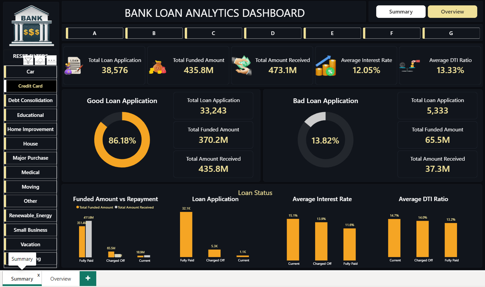
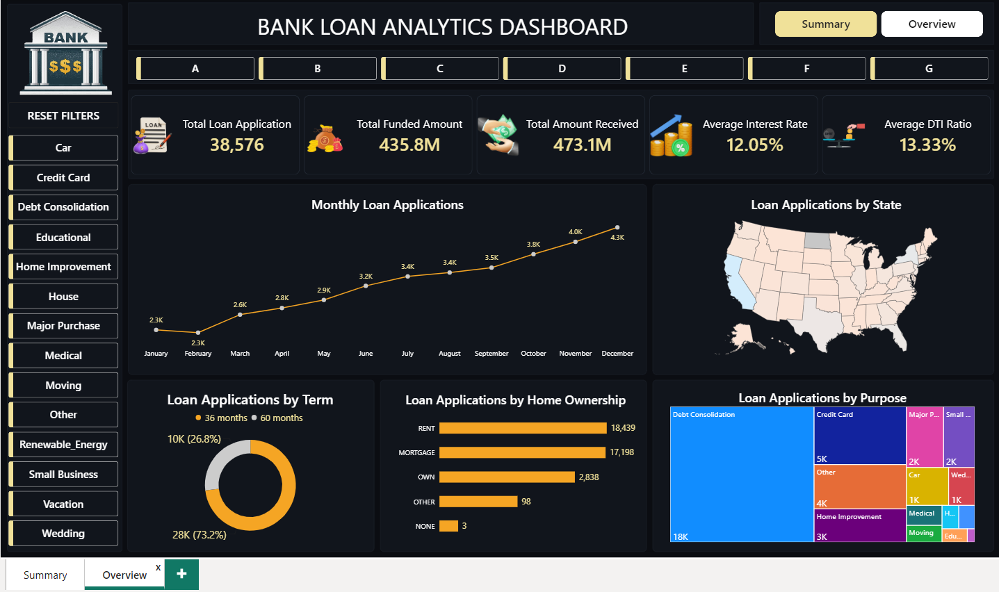

# Credit Portfolio Performance Analysis

**Loan Portfolio Analysis · Repayment Performance · Credit Risk**\
**PostgreSQL \| SQL \| Power BI \| DAX \| Excel**

## Project Overview

This project examines a consumer loan portfolio using PostgreSQL and
Power BI. It focuses on the size and composition of the portfolio, the
amount funded, payments recorded, loan status and differences in
charged-off activity across borrower and loan segments.

The analysis starts with data checks and exploratory SQL queries, then
moves to business questions about credit grades, loan purposes, loan
terms, verification status and geographic exposure. The results are
presented in a two-page Power BI report.

The project is intended to show how a raw loan dataset can be explored,
analysed and turned into a set of business-facing metrics and visual
reports.

## Contents

-   [Project Objectives](#project-objectives)
-   [Dataset](#dataset)
-   [Tools and Technologies](#tools-and-technologies)
-   [Analysis Workflow](#analysis-workflow)
-   [SQL Analysis](#sql-analysis)
-   [Power BI Report](#power-bi-report)
-   [Key Metrics and Findings](#key-metrics-and-findings)
-   [Metric Definitions and Important
    Notes](#metric-definitions-and-important-notes)
-   [Repository Structure](#repository-structure)
-   [How to Reproduce the Analysis](#how-to-reproduce-the-analysis)
-   [Limitations](#limitations)
-   [Source and Attribution](#source-and-attribution)

## Project Objectives

The analysis was built around the following questions:

1.  What is the total number of loan applications and the total amount
    funded?
2.  How much payment has been recorded against the loans?
3.  How are applications distributed across loan status, credit grade,
    purpose and term?
4.  Which credit grades have the highest number and share of charged-off
    loans?
5.  How does charged-off activity differ across loan purposes and
    verification groups?
6.  Which states account for the largest loan volumes and funded
    amounts?
7.  How has application and funding activity changed over the reporting
    period?
8.  How do average interest rates and debt-to-income ratios vary by
    credit grade?

The purpose is descriptive analysis: to identify patterns in the
supplied portfolio and make those patterns easier to review. The results
do not establish that a particular borrower characteristic causes a loan
to be charged off.

## Dataset

The project uses the `financial_loan.csv` file included in the
repository.

  Dataset detail                                  Value
  ------------------ ----------------------------------
  Loan records                                   38,576
  Columns                                            23
  First issue date                      01 January 2021
  Last issue date                      12 December 2021
  Loan statuses        Fully Paid, Charged Off, Current

The dataset contains loan-level information, including:

**Loan details** - Issue date - Loan amount - Loan term - Installment -
Loan purpose - Loan status

**Credit and repayment information** - Credit grade and sub-grade -
Interest rate - Debt-to-income ratio (DTI) - Total payment - Total
accounts

**Borrower information** - Annual income - Employment length and title -
Home ownership - Verification status - State

The reporting period ends on 12 December 2021, so December is a partial
month rather than a complete reporting month.

## Tools and Technologies

  -----------------------------------------------------------------------
  Tool                                Role in the project
  ----------------------------------- -----------------------------------
  PostgreSQL                          Database table creation and SQL
                                      analysis

  SQL                                 Data checks, exploratory analysis,
                                      aggregations and business queries

  Microsoft Power BI                  Interactive reporting and data
                                      visualization

  DAX                                 Measures and KPI calculations in
                                      the Power BI report

  Microsoft Excel                     Workbook copy of the source dataset
                                      for inspection
  -----------------------------------------------------------------------

The Excel workbook contains the source data. It is not a separate Excel
dashboard or PivotTable analysis, so the main analytical work in this
project is performed in PostgreSQL and Power BI.

## Analysis Workflow

``` text
Source CSV
   |
   v
PostgreSQL table
   |
   v
Data checks and exploratory analysis
   |
   v
Business-focused SQL queries
   |
   v
Portfolio and credit-risk findings
   |
   v
Power BI measures and report
   |
   v
Summary and Overview dashboards
```

## SQL Analysis

The SQL work is organized into two stages.

### 1. Database Setup and Exploratory Analysis

The setup and EDA script creates the `financial_loan` table and explores
the structure and contents of the dataset.

The checks and queries cover:

-   Total record count and column review
-   Duplicate checks for loan IDs and member IDs
-   Missing-value checks
-   Earliest and latest issue dates
-   Loan status distribution
-   Loan purpose, grade and sub-grade distribution
-   Home ownership and verification status
-   Loan term and state distribution
-   Minimum, maximum and average loan amounts
-   Borrower income statistics
-   Average interest rate and DTI
-   Loan amount and income ranges
-   Average loan amount by grade
-   Loan status by grade
-   Monthly applications and funded amount
-   Charged-off loan counts and amounts
-   Good, Bad and Current loan categories

### 2. Business Questions

The second SQL script contains 15 business-focused queries. They
examine:

-   Total loan applications and total loan amount
-   Total payment recorded
-   Difference between total loan amount and total payment
-   Charged-off loans by credit grade
-   Loan amount and application volume by state
-   Charged-off amount by state
-   Average interest rate by grade
-   Monthly portfolio activity
-   Average DTI by grade
-   Charged-off amount by grade
-   Distribution of Good, Bad and Current loans
-   Charged-off share by grade
-   Charged-off share by loan purpose
-   Charged-off share by loan term
-   Charged-off share by verification status

The queries use PostgreSQL features such as `DATE_TRUNC()`, `FILTER`,
`CASE`, aggregate functions, subqueries and type casting.

## Power BI Report

The Power BI report is split into two pages so that the main portfolio
indicators and the more detailed breakdowns can be reviewed separately.

### Summary Dashboard

The Summary page provides a high-level view of the loan portfolio.

It includes: - Total Loan Applications - Total Funded Amount - Total
Amount Received - Average Interest Rate - Average DTI - Good Loan
Applications - Bad Loan Applications - Loan applications by status -
Funded amount compared with amount received by loan status - Average
interest rate and DTI by loan status



### Overview Dashboard

The Overview page focuses on how the portfolio is distributed across
time, geography and borrower or loan categories.

It includes: - Monthly loan applications - Loan applications by state -
Loan applications by term - Home ownership distribution - Loan purpose
distribution - Credit grade analysis

The report also includes slicers, page navigation and a reset-filters
control to make it easier to explore different segments.



## Key Metrics and Findings

The following figures are based on the supplied dataset and the
calculations included in the project report.

### Portfolio Snapshot

  Metric                                       Result
  --------------------------------------- -----------
  Loan applications                            38,576
  Total funded amount                       \$435.76M
  Total amount received                     \$473.07M
  Average interest rate                        12.05%
  Average DTI                                  13.33%
  Charged-off loans                             5,333
  Charged-off share of all applications        13.82%

### Loan Status Breakdown

  Loan status     Applications      Share
  ------------- -------------- ----------
  Fully Paid            32,145     83.33%
  Charged Off            5,333     13.82%
  Current                1,098      2.85%
  **Total**         **38,576**   **100%**

The dashboard groups Fully Paid and Current loans as Good Loans, and
Charged Off loans as Bad Loans. Under this dashboard grouping, Good
Loans account for 33,243 applications (86.18%), while Bad Loans account
for 5,333 applications (13.82%).

### Charged-Off Share by Credit Grade

  Grade     Applications   Charged-off loans   Charged-off share
  ------- -------------- ------------------- -------------------
  A                9,689                 552               5.70%
  B               11,674               1,343              11.50%
  C                7,904               1,266              16.02%
  D                5,182               1,072              20.69%
  E                2,786                 691              24.80%
  F                1,028                 311              30.25%
  G                  313                  98              31.31%

The charged-off share is higher in the lower-rated grades in this
dataset. Average interest rate also rises across the grades, from 7.35%
for Grade A to 21.40% for Grade G.

### Loan Term Comparison

  Term          Applications   Charged-off loans   Charged-off share
  ----------- -------------- ------------------- -------------------
  36 months           28,237               3,023              10.71%
  60 months           10,339               2,310              22.34%

The observed charged-off share is higher for the 60-month group than for
the 36-month group.

### Loan Purpose

Small Business loans have the highest observed charged-off share among
the listed purposes at 25.62%. Debt Consolidation is the largest purpose
group by application volume, with 18,214 applications.

### Geographic Exposure

California has the largest funded amount among the states shown in the
report, at approximately \$78.5M. It also has approximately \$13.1M in
charged-off loan amount.

These findings describe the records in this dataset. They should be used
as starting points for further investigation, not as evidence that
grade, term, purpose or location independently causes a loan outcome.

## Metric Definitions and Important Notes

To make the results easier to interpret, the main measures are defined
as follows:

  -----------------------------------------------------------------------
  Metric                              Definition
  ----------------------------------- -----------------------------------
  Total Loan Applications             Count of records in the loan table

  Total Funded Amount                 Sum of `LOAN_AMOUNT`

  Total Amount Received               Sum of `TOTAL_PAYMENT`

  Average Interest Rate               Average of `INT_RATE`, displayed as
                                      a percentage

  Average DTI                         Average of `DTI`, displayed as a
                                      percentage

  Charged-Off Share                   Charged-off loans divided by all
                                      loans in the relevant group
  -----------------------------------------------------------------------

**Good Loan and Bad Loan grouping**

The Power BI dashboard uses the following grouping: - Good Loans = Fully
Paid + Current - Bad Loans = Charged Off

The SQL status-distribution query keeps Current as a separate category.
These two presentations therefore use different groupings and should not
be compared as if they were identical.

A Current loan has not necessarily completed repayment. The dashboard's
Good Loan label is a reporting category, not confirmation that every
loan in that group has been fully repaid.

**Charged-off share denominator**

The charged-off share queries divide the number of Charged Off loans by
all loan records in the relevant group. Current loans are included in
the denominator. This is a portfolio share, not a default rate
calculated only on loans with a completed outcome.

**Payments and profitability**

Total amount received is the sum of recorded payments. The difference
between total payments and total funded amount should not be treated as
net profit. The dataset does not include all costs, expenses or
accounting details needed to calculate profitability.

**Reporting period**

The latest issue date is 12 December 2021. December is therefore
incomplete and should be interpreted carefully in month-to-month
comparisons.

## Repository Structure

``` text
credit-portfolio-performance-analysis/
│
├── data/
│   └── raw/
│       └── financial_loan.csv
│
├── excel/
│   └── loan_portfolio_analysis.xlsx
│
├── images/
│   ├── APPLICATIONS.png
│   ├── AVG DTI.png
│   ├── AVG INT RATE.png
│   ├── BANK.png
│   ├── Dashboard.svg
│   ├── Overview.svg
│   ├── TOTAL AMOUNT RECEIVED.png
│   └── TOTAL FUNDED AMOUNT.png
│
├── power_bi/
│   ├── bank_loan_analytics.pbix
│   └── screenshots/
│       ├── summary_dashboard.png
│       └── overview_dashboard.png
│
├── reports/
│   └── bank_loan_analytics_report.pdf
│
├── sql/
│   ├── 01_database_setup_and_eda.sql
│   └── 02_business_questions.sql
│
└── README.md
```

## How to Reproduce the Analysis

### Requirements

-   PostgreSQL
-   pgAdmin or another PostgreSQL client
-   Power BI Desktop

### PostgreSQL

1.  Create a database for the project.
2.  Open the database in pgAdmin or your preferred SQL client.
3.  Run the database setup and EDA script to create the `financial_loan`
    table.
4.  Import `data/raw/financial_loan.csv` into the table, using the first
    row as the column header.
5.  The date fields in the CSV use the `DD-MM-YYYY` format. Set or
    confirm the PostgreSQL date interpretation as `DMY` during import.
6.  Run the business questions script to reproduce the portfolio queries
    and calculations.

### Power BI

1.  Open `power_bi/bank_loan_analytics.pbix` in Power BI Desktop.
2.  If the report refers to a different local CSV location, update the
    data source path.
3.  Refresh the report.
4.  Review the Summary and Overview pages and use the available filters
    to explore the portfolio.

## Limitations

-   The dataset covers a historical period in 2021 and does not
    represent current lending conditions.
-   December contains data only through 12 December.
-   The analysis is descriptive and does not include a predictive
    credit-risk model.
-   The project does not establish causal relationships between borrower
    characteristics and charged-off outcomes.
-   Current loans have not necessarily reached a final repayment
    outcome.
-   The Excel workbook is included as a copy of the source dataset; the
    analytical workflow is based on PostgreSQL and Power BI.
-   Total payments are not a substitute for a full profitability
    calculation.

## Source and Attribution

This repository is an adapted portfolio presentation of the project
originally published by **Sujal Mondal**:

[Original GitHub repository --- Bank Loan Analytics
Dashboard](https://github.com/CodeWithSujal28/Bank-Loan-Analytics-Dashboard-SQL-PowerBI)

The original author and source project are credited here. The repository
structure and documentation have been reorganized for this portfolio
version.

The source repository reviewed for this project did not contain a
license file. Public availability on GitHub does not, by itself, grant
permission to redistribute or republish the original code, dashboard,
report or other materials. Permission from the original author should be
obtained before publishing a derivative copy.

------------------------------------------------------------------------

**Portfolio maintainer:** Mahir Abbasli\
**Project focus:** PostgreSQL · SQL · Power BI · DAX · Credit Portfolio
Analysis
